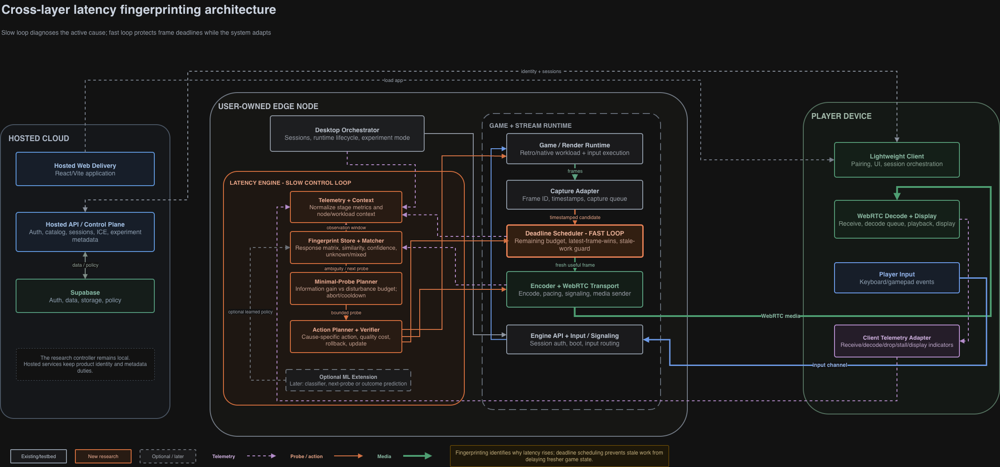

# Latency-fingerprinting architecture

The project separates a Python offline research core from the Pixelated
TypeScript/Node, browser and camera runtime. Records and versioned bundles form
the integration boundary.

## Responsibilities

Pixelated owns telemetry collection, game/session lifecycle, Electron/Docker
orchestration, runtime settings, bounded scenario actions and artifact export.
The Python core owns contract validation, measurement aggregation, response
derivation, normalization, fingerprint repositories, matching and offline
experiment inspection.

The core analyzes recorded interventions; it does not execute them against a
live engine. Per-frame decisions belong in the capture/GStreamer process rather
than a slow external Python controller.

## Data flow

```text
Pixelated or synthetic source
  -> versioned raw bundle / observation windows
  -> validated source samples and registered aggregation
  -> comparable degraded + relief windows + intervention
  -> analytical response and explicit normalization policy
  -> compatible stored fingerprints
  -> interpretable match or unknown
```

P0 uses its frozen observation-v1 feature configuration. The additive v2 path
binds observation records to a canonical metric registry and an explicit approved
feature policy. Neither path silently changes the other's metric meanings.

## Measurement and matching layers

- `measurement/` defines the 31-output registry, gauge/counter aggregation and
  unavailable stage-timing declarations.
- `adapters/` validates Pixelated archives, CSVs, identity and clocks, then adopts
  source samples and observation records.
- `models/` defines strict versioned records. Generated JSON Schemas check shape;
  Python validators also enforce cross-field and numerical consistency.
- `analytical/` derives v2 responses, validates stored fingerprints, checks
  compatibility and computes conservative similarity decisions.
- The original P0 modules retain their separate comparability, normalization and
  matching behavior.

See the [registry](measurement/CANONICAL_REGISTRY.md),
[observation contract](measurement/OBSERVATION_V2_CONTRACT.md),
[analytical contract](analysis/N3_ANALYTICAL_CONTRACT.md) and
[matching guide](analysis/N3_MATCHING.md).

## Stage observability

Pixelated's opt-in host probes collect capture output, queue entry/exit and encoder
input/output. Browser collectors record presentation and callback endpoints.
This core validates trace bundles and reconstructs same-lifetime timing.

Pairs stay within one stream, epoch, clock and exact frame association. Independent
producer clocks are unsynchronized. Unsupported boundaries, missing endpoints,
negative durations, sampling and loss stay explicit. No export or core call runs
inside frame callbacks. N2 stage timing remains unavailable; standalone N4 traces
are not silently promoted into N3 features.

See the [trace contract](observability/N4_TRACE_CONTRACT.md),
[adoption guide](observability/N4_TRACE_ADOPTION.md) and
[timing reconstruction](observability/N4_TIMING_RECONSTRUCTION.md).

## Scenario experiments

The producer harness runs six-phase bounded experiments under a private ownership
lease. It captures counters and fresh phase recordings, applies supported CPU or
capture-pacing actions, and records cleanup outcomes. The detached inspector
verifies exact artifact membership, hashes, ownership and effect arithmetic.

An action starting does not establish a measured effect. Hashes and declared source
IDs do not prove scientific independence or causality. See the
[experiment contract](scenarios/N5_EXPERIMENT_CONTRACT.md),
[lifecycle](scenarios/N5_RUN_LIFECYCLE.md) and
[campaign workflow](scenarios/N5_CAMPAIGN_WORKFLOW.md).

## Calibration and profiles

N6 inspects linked evidence, connected source groups and frozen split assignments.
N7 fits training-only group medians and raw-MAD profiles, retaining exclusions and
explicit immutable lifecycle revisions. Supported profiles remain provisional.
See [calibration inspection](calibration/N6_INSPECTION.md) and
[profile building](profiles/N7_COMMANDS.md).

The additive [N8 matching method](profile_matching/N8_MATCH_CONTRACT.md) specifies
offline label comparisons on a shared feature mask and whole-source-group refits
for evaluation. [Standalone N8 models](profile_matching/N8_MODELS.md) reconstruct
retained scoring/evaluation declarations; linked source inspection and commands
remain unimplemented. Existing point-fingerprint matching keeps its separate behavior.

## File and numeric boundaries

Public JSON readers reject duplicate keys, nonfinite numbers, excessive nesting,
invalid UTF-8 and oversized input. Bundle readers bound compressed/expanded bytes,
members and CSV rows, reject unsafe links and paths, and cross-check identity and
clock alignment. Fingerprint loading bounds directory depth and entry count.
Arithmetic is checked after derivation as well as at ingestion so finite inputs
cannot silently become infinite or unusable scores.

## Repository layout

```text
docs/                       Contracts, API guides and reusable workflows
src/latency_fingerprinting/  Models, adapters, measurement and analysis
schemas/                    Generated schemas and canonical registry
fixtures/                   Versioned synthetic inputs and expected results
experiments/                Sanitized recorded experiments and processing tools
tests/                      Unit, integration, reproduction and packaging checks
```

Python 3.11+ and Pydantic provide the offline model/analysis layer. The CLI uses
standard-library argparse. Runtime dependencies and development tools are declared
in `pyproject.toml`; virtual environments and private raw captures are ignored.

## Intended extensions and limits



The diagram includes intended diagnosis/control and deadline-scheduling extensions.
Live probe planning, autonomous corrective actions, outcome-based learning,
mixed-cause inference and calibrated probabilities are not implemented by the
current offline matcher. Match strength is an engineering similarity measure.
The camera currently applies stream profiles at launch; paired-run relief does
not imply safe live encoder mutation or rollback.
